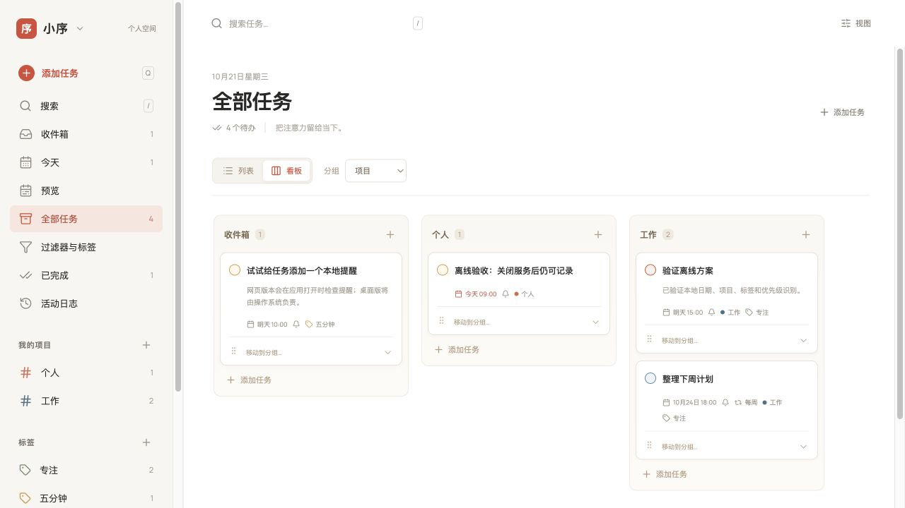

# 小序（Xu Todo）

小序是一款本机优先的待办事项管理应用，提供任务清单、日历速览和分组看板。应用以静态网页运行，任务数据保存在当前浏览器中，无需注册账户或配置后端服务。

[在线使用](https://chaolinhan.github.io/xu-todo/) · [源码仓库](https://github.com/chaolinhan/xu-todo) · [使用指南](docs/usage.md)



## 主要功能

任务管理支持项目、版块、标签、优先级、截止时间、提醒，以及任务的完成、恢复与撤销。快速录入可以识别中文日期、时间、项目、标签和优先级，例如 `明天下午3点 准备会议 #工作 @专注 p1`。项目与标签需要提前创建，无法识别的内容会保留在任务标题中。

预览页面提供日、周、月速览，可按日期查看安排并直接编辑任务。列表和看板使用相同的分组规则，支持按版块、日期、优先级、项目和标签组织任务。项目内的版块可以自定义，任务可以通过拖动或移动控件在分组之间调整。

过滤器支持保存常用查询条件，组合日期、优先级、项目、标签和关键字进行筛选。活动日志记录任务与组织结构的变化；已完成任务可以独立查看和恢复。重复任务按日历规则生成后续实例，支持每天、工作日、每周、每月、每年及自定义间隔。

## 快速开始

### 在线使用

打开 [小序在线版](https://chaolinhan.github.io/xu-todo/)。首次联网访问并等待离线资源就绪后，可以在支持的浏览器中继续离线使用，也可以通过浏览器菜单将其安装为应用。

在线版与本机预览使用不同的浏览器存储空间。迁移已有任务时，请从原地址的“设置与备份”导出 JSON，再在目标地址导入。

### 本地开发

推荐使用 Node.js 24 与 npm；持续集成采用相同的 Node.js 主版本。

```bash
git clone https://github.com/chaolinhan/xu-todo.git
cd xu-todo
npm ci
npm run dev
```

开发地址为 `http://127.0.0.1:4178/`。开发模式不注册离线缓存；验证离线能力时，应使用生产构建。

| 命令 | 用途 |
| --- | --- |
| `npm run dev` | 启动本地开发服务 |
| `npm test` | 运行自动化测试 |
| `npm run typecheck` | 检查 TypeScript 类型 |
| `npm run build` | 构建本机生产版及 Windows 便携目录 |
| `npm run preview` | 在本机预览生产构建 |
| `npm run build:pages` | 构建 GitHub Pages 版本 |

### Windows 便携运行

执行 `npm run build` 后，将生成的 `release/xiaoxu-offline/` 整个目录复制到 Windows，双击其中的 `Start-Windows.cmd`。启动器使用系统 PowerShell，在 `127.0.0.1:4178` 提供静态文件并打开浏览器；运行时不需要 Node.js、互联网或管理员权限。请保留启动窗口，推荐使用 Edge 或 Chrome。

启动脚本仅为本次 PowerShell 进程设置执行策略，不修改系统策略；受组织管理的设备可能限制脚本运行。Windows 启动器尚未完成实机验收。

## 数据与离线机制

任务、项目、版块、标签、过滤器、日志和显示偏好存储于浏览器的 IndexedDB。应用不上传任务数据，也不提供自动跨设备同步。不同浏览器、域名、端口或浏览器配置文件之间的数据不会自动共享。

“设置与备份”提供 JSON 导入和导出。备份包含任务内容与日志，应妥善保管；导入会在确认后替换当前数据。清理网站数据、使用临时浏览器配置文件或更换设备前，请先导出备份。

生产版使用 Service Worker 缓存应用资源和字体。在线部署需要首次联网加载；Windows 便携目录包含完整静态资源，可在没有互联网的环境中首次运行。浏览器完全退出后的准时提醒不在网页版本的能力承诺范围内。

## 部署

推送到 `main` 后，[GitHub Actions](.github/workflows/pages.yml) 会安装依赖、运行测试、构建站点并发布至 GitHub Pages。也可以在 Actions 页面手动触发部署。

Pages 构建使用 `/xu-todo/` 基础路径，输出至 `dist-pages/`。本机生产构建使用根路径，输出至 `dist/`，两者互不覆盖。若调整仓库名称或部署路径，需要同步修改 `vite.config.ts` 和 `package.json` 中的 Pages 构建命令。

## 项目结构

```text
src/components/       界面组件
src/lib/              任务、日历、过滤器、分组及存储逻辑
public/               图标、应用清单与离线缓存脚本
scripts/              构建与便携运行脚本
tests/                离线缓存测试
docs/                 使用说明、设计决策与验证记录
.github/workflows/    持续集成与 Pages 部署
```

界面使用 React、TypeScript、Vite 和 Lucide；字体资源随构建提供。依赖许可说明见 [第三方声明](scripts/portable/THIRD-PARTY-NOTICES.txt)。行为细节与已知限制请参阅[使用指南](docs/usage.md)和[验证记录](docs/research/verification.md)。
